<!--
  EVANK253 / PROFILE INTERFACE
  Investor-facing portfolio overview. Proprietary implementation details remain private.
-->

  

  <strong>INDEPENDENT SYSTEMS ENGINEERING</strong> 
  AI Systems · Superintelligence Research · Engineering Intelligence · Human-Governed Architecture

  <a href="https://github.com/Evank253?tab=repositories">EXPLORE THE WORK</a>
  &nbsp;·&nbsp;
  <a href="https://github.com/Evank253?tab=activity">DEVELOPMENT ACTIVITY</a>
  &nbsp;·&nbsp;
  <a href="https://github.com/sponsors/Evank253"><strong>♥ SPONSOR THE WORK</strong></a>
  &nbsp;·&nbsp;
  <a href="https://gravatar.com/evanketchum2000">PROFILE</a>

---

## LIVE GITHUB COMMAND CENTER

  

  <a href="https://github.com/Evank253?tab=overview"><strong>◈ PROFILE</strong></a>
  &nbsp; · &nbsp;
  <a href="https://github.com/Evank253?tab=repositories"><strong>⌘ REPOSITORIES</strong></a>
  &nbsp; · &nbsp;
  <a href="https://github.com/Evank253?tab=stars"><strong>✧ OPEN-SOURCE INTERESTS</strong></a>

GitHub's own profile page displays the authoritative contribution calendar below this README. The dashboard above is a visual portfolio map; its meters describe areas of focus and are not measured intelligence scores or performance benchmarks.

### Contribution animation

The live contribution calendar is provided by GitHub itself on your profile page. I removed the third-party animation embed so it cannot break the portfolio when its image host is unavailable.

## THE BUILDER

I’m Evan Ketchum, an independent systems engineer and technical founder developing a portfolio of intelligent systems focused on governed AI, engineering execution, computational research, and infrastructure continuity.

My work is shaped by two disciplines: building and leading real-world telecommunications infrastructure, and independently designing software architectures that make complex systems more accountable, inspectable, and useful.

I bring **14 years of telecommunications and field-infrastructure experience**, including **13 years in foreman leadership**, together with ongoing software engineering study and independent research and development.

**My focus:** build systems that do more than produce outputs — systems whose processes, evidence, boundaries, and human accountability can be examined.

## THE SYSTEMS PORTFOLIO

<table>
  <tr>
    <td width="50%" valign="top">
      <h3>01 / KCN</h3>
      <strong>Ketchum Cognitive Network</strong> 
      A human-governed intelligence architecture exploring coordinated tools, controlled execution, traceable decisions, and accountable AI behavior.
    </td>
    <td width="50%" valign="top">
      <h3>02 / MANIFEX</h3>
      <strong>Engineering Intelligence &amp; Execution</strong> 
      An engineering environment for artifact discovery, inspection, qualification workflows, execution evidence, and reusable engineering outcomes.
    </td>
  </tr>
  <tr>
    <td width="50%" valign="top">
      <h3>03 / GENESIS SEED</h3>
      <strong>Data Continuity &amp; Lineage</strong> 
      Research into identity, state, provenance, and reconciliation across distributed systems and fragmented data environments.
    </td>
    <td width="50%" valign="top">
      <h3>04 / SCIENTIFIC INTELLIGENCE</h3>
      <strong>Computational Research</strong> 
      Work exploring mathematical computation, forward and backward problem solving, optimization, simulation, and verification.
    </td>
  </tr>
</table>

## WHAT I DO

- **AI and intelligent-systems engineering** — design architectures for coordinated, tool-using systems with explicit operating boundaries.
- **Systems architecture and integration** — connect components, workflows, data, and services into coherent technical environments.
- **Governance and assurance** — develop human-oversight, evidence, authorization, and fail-closed design patterns.
- **Engineering automation** — build workflow orchestration, preflight checks, testing paths, and execution-evidence pipelines.
- **Cybersecurity-minded engineering** — assess trust boundaries, identity, access, failure modes, and system integrity.
- **Computational and scientific research** — investigate mathematical models, optimization, simulation, and reproducible verification.
- **Infrastructure and field operations** — bring practical experience in aerial and underground construction, fiber and copper networks, cell sites, and data-center infrastructure.

## CORE STRENGTHS

| Strength | How it shows up in my work |
| --- | --- |
| Systems thinking | See dependencies, interfaces, and lifecycle behavior — not just isolated features. |
| Architecture and integration | Break complex goals into components with defined responsibilities. |
| Operational leadership | 14 years in infrastructure work, including 13 years leading field crews. |
| Governance-first design | Keep human accountability distinct from software capability and automated output. |
| Evidence-driven execution | Separate what is implemented, tested, measured, qualified, and approved. |
| Troubleshooting under pressure | Diagnose real-world problems and coordinate safe, practical execution. |
| Independent research and development | Move from a question to a structured investigation, prototype, and verification path. |

## ENGINEERING PRINCIPLES

- **Human authority stays external:** software can assist a decision; it cannot grant itself authority.
- **Evidence before claims:** implementation, test results, qualification, and approval are different things.
- **Fail closed:** unresolved or unmeasured conditions remain visible rather than being silently treated as success.
- **Preserve provenance:** changes, artifacts, and decisions should be traceable.
- **Build incrementally:** protect existing work and make development auditable.
- **Practical systems thinking:** account for interfaces, dependencies, operational constraints, and failure conditions.

## SELECTED PUBLIC WORK

- [Ketchum's Physics-Optimized Super-Intelligence AI](https://github.com/Evank253/Ketchums-physics-optimized-super-intelligence-ai) — public research and engineering showcase.
- [World View](https://github.com/Evank253/world-view) — public systems and interface work.
- [Worldview Command Center of Technologies](https://github.com/Evank253/worldviewcommandcenteroftechnologies) — public command-center and technology work.
- [Browse all public repositories](https://github.com/Evank253?tab=repositories).

Some projects and implementation details are private or under active development. Public descriptions are intentionally high-level; access to proprietary source, internal architecture, and detailed evidence is controlled. Project maturity varies, and no claim is made that every component is fully integrated or production-ready.

## CODE ACHIEVEMENTS & ENGINEERING PROOF

These are project-backed engineering milestones—not third-party coding certificates. Each card points to a public repository or evidence artifact so visitors can inspect the underlying work.

<table>
  <tr>
    <td width="50%" valign="top">
      <h3>⌘ KCN · GOVERNED INTELLIGENCE</h3>
      
<strong>Human-governed AI architecture</strong>

      
Public project documentation describes a modular ecosystem built around human governance, verification, security, knowledge, and controlled execution.

      <a href="https://github.com/Evank253/KCN-SUPER-COGNITIVE-HUMAN-GOVERNED-INTELLIGENCE-ECOSYSTEM-">VIEW REPOSITORY →</a>
    </td>
    <td width="50%" valign="top">
      <h3>◈ QUANTARA · COMPUTATIONAL RESEARCH</h3>
      
<strong>Independent mathematical and computational research</strong>

      
Public repository materials document the research direction and associated technical claims. Research claims should be evaluated against their underlying methods and evidence.

      <a href="https://github.com/Evank253/Quantara-Core">VIEW REPOSITORY →</a>
    </td>
  </tr>
  <tr>
    <td width="50%" valign="top">
      <h3>⬡ KCN · CERTIFICATION TOOLING</h3>
      
<strong>Evidence and certificate-generation code</strong>

      
Public code includes certificate-generation and capability-certificate components. These are software artifacts, not independent professional accreditation.

      <a href="https://github.com/Evank253/Global-Intelligence">INSPECT CODE →</a>
    </td>
    <td width="50%" valign="top">
      <h3>✓ PUBLIC BUILD & TEST TRAIL</h3>
      
<strong>Repository-level implementation evidence</strong>

      
Review source history, project documentation, tests, and CI status directly in the public repositories. Results are scoped to the specific revision and test suite shown.

      <a href="https://github.com/Evank253?tab=repositories">BROWSE PUBLIC PROJECTS →</a>
    </td>
  </tr>
</table>

  <a href="https://github.com/Evank253/KCN-SUPER-COGNITIVE-HUMAN-GOVERNED-INTELLIGENCE-ECOSYSTEM-/actions"><strong>⌘ VIEW PUBLIC BUILD &amp; TEST HISTORY</strong></a>
  &nbsp; · &nbsp;
  <a href="https://github.com/Evank253?tab=activity"><strong>◷ VIEW DEVELOPMENT ACTIVITY</strong></a>

## TRAINING & PROFESSIONAL CREDENTIALS

My field background includes training and credentials in:

- OSHA 30
- Flagger / traffic-control training
- Confined-space training
- CPR and First Aid
- AutoCAD training

Certificate scans, issuing organizations, credential IDs, and completion dates are not yet published here. I will only display formal certificate images or issuer-verifiable credentials once the original records are available. I do not present training credentials as academic degrees, coding certifications, or professional licenses.

## EDUCATION

Software Engineering studies — University of Advancing Technology (online).

## SUPPORT INDEPENDENT DEVELOPMENT

I’m building this work independently. Sponsorship helps create dedicated development time and supports testing infrastructure, research, documentation, security review, and the continued maintenance of public-facing work.

  <a href="https://github.com/sponsors/Evank253"><strong>♥ BECOME A GITHUB SPONSOR</strong></a>

For organizations interested in collaboration, technical evaluation, or supporting open-source engineering, please reach out through GitHub.

---

  <strong>EVAN KETCHUM</strong> 
  Independent Systems Engineering · Research · Development 
  Build with purpose. Verify with evidence. Keep humans accountable.

