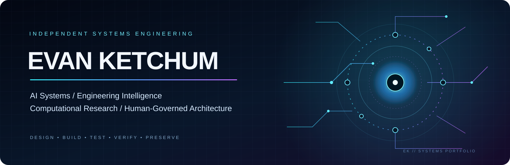

<!--
  EVANK253 / PROFILE INTERFACE
  Public portfolio overview. Technical descriptions are intentionally high-level.
-->

  

  <strong>INDEPENDENT SYSTEMS ENGINEERING</strong> 
  AI Systems · Engineering Intelligence · Computational Research · Human-Governed Architecture

  <a href="https://github.com/Evank253?tab=repositories">REPOSITORIES</a>
  &nbsp;·&nbsp;
  <a href="https://github.com/Evank253?tab=activity">ACTIVITY</a>
  &nbsp;·&nbsp;
  <a href="https://gravatar.com/evanketchum2000">PROFILE</a>

---

## SYSTEMS OVERVIEW

I independently design, build, and evaluate software systems focused on intelligent engineering workflows, governed computation, system continuity, and scientific problem-solving.

My work brings together software architecture, field engineering experience, iterative experimentation, and evidence-driven development. The projects below represent the principal research and engineering directions across my repositories.

<table>
  <tr>
    <td width="50%" valign="top">
      <h3>01 / KCN</h3>
      <strong>Ketchum Cognitive Network</strong> 
      A human-governed intelligence architecture exploring coordination, controlled tool use, and accountable system behavior.
    </td>
    <td width="50%" valign="top">
      <h3>02 / MANIFEX</h3>
      <strong>Engineering Intelligence &amp; Execution</strong> 
      An engineering environment focused on artifact discovery, inspection, qualification, execution evidence, and reusable outcomes.
    </td>
  </tr>
  <tr>
    <td width="50%" valign="top">
      <h3>03 / GENESIS SEED</h3>
      <strong>Data Continuity &amp; Reconciliation</strong> 
      Research into identity, state, lineage, and consistency across distributed systems and fragmented data environments.
    </td>
    <td width="50%" valign="top">
      <h3>04 / SCIENTIFIC INTELLIGENCE</h3>
      <strong>Computational Research</strong> 
      Work exploring mathematical computation, multi-directional problem solving, optimization, and verification.
    </td>
  </tr>
</table>

## ENGINEERING WORKFLOW

A broader development direction connects specialized engineering stages into a governed workflow:

  <code>DISCOVER</code> &nbsp;→&nbsp; <code>INSPECT</code> &nbsp;→&nbsp; <code>BUILD</code> &nbsp;→&nbsp; <code>TEST</code> &nbsp;→&nbsp; <code>VERIFY</code> &nbsp;→&nbsp; <code>REGISTER</code>

Related areas include development automation, preflight checks, code-generation workflows, security evaluation, benchmarking, and evidence capture.

**Integration status matters:** these projects and components are at different stages of implementation and validation. This portfolio does not imply that every component is fully integrated or production-ready. Test results and maturity claims should be evaluated against the evidence in each individual repository.

## ENGINEERING PRINCIPLES

- **Human accountability:** automation supports human decision-making; it does not grant itself authority.
- **Evidence before claims:** distinguish implementation, test results, qualification, and approval.
- **Fail-closed thinking:** unresolved or unmeasured conditions should remain visible.
- **Incremental development:** preserve history and make changes traceable.
- **Systems-level reasoning:** consider interfaces, dependencies, failure modes, and lifecycle—not only individual features.

## TECHNICAL BACKGROUND

My engineering perspective is shaped by both software development and 14 years of hands-on telecommunications and field construction leadership, including aerial and underground infrastructure, fiber and copper systems, data-center work, and field operations.

That experience informs how I approach complex systems: plan the work, understand dependencies, account for real-world failure conditions, and verify the result.

## EXPLORE THE WORK

  <a href="https://github.com/Evank253?tab=repositories"><strong> BROWSE PUBLIC REPOSITORIES → </strong></a>

  Independent work · Systems architecture · Continuous research and development

